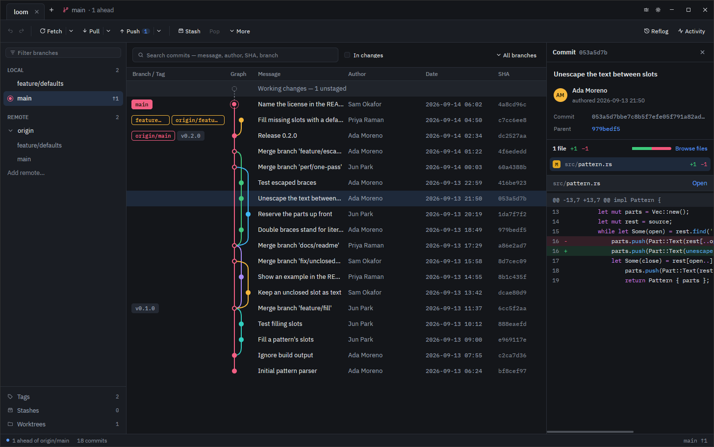

<div align="center">


# Gitweft

**A fast, fully offline Git client for Linux.**

[Why I wrote it](#why-i-wrote-it) · [What it does](#what-it-does) · [How fast it is](#how-fast-it-is) ·
[Install](#install) · [Build it yourself](#build-it-yourself) · [What it is made of](#what-it-is-made-of) ·
[Contributing](#contributing) · [License](#license)

</div>

<picture>
  <source media="(prefers-color-scheme: light)" srcset="docs/screenshots/graph-light.png">
  
</picture>

Gitweft shows a repository as a commit graph, lets you stage down to a single line, walks you
through merge conflicts and interactive rebases, and keeps an undo history for the local
operations that usually make people nervous. It is a native Rust application drawn on the GPU,
and it never opens a network connection of its own.

## Why I wrote it

I wrote Gitweft for myself. I work on Linux, I spend a good part of every day in git, and none of
the graphical clients I tried were comfortable to live in. So this is, first of all, the tool I
wanted on my own desk. I am publishing it because it might be useful to someone in the same spot.
If it turns out not to be quite what you need, that is fair; the source is here, and so is the
issue tracker.

Two things shaped it more than anything else.

**Big repositories.** The projects I care about have long histories, and every client I tried
started to lag at some point. The graph would stutter, a click would take a second, and sooner or
later I would give up and go back to the terminal. Gitweft was built to stay quick on histories
of a million commits and more; the numbers are [below](#how-fast-it-is).

**It is my computer.** I think what is on my machine should stay with me, not with some company.
Gitweft has no accounts, no cloud features, no telemetry, no update checks and no crash reports.
The application process never opens an internet socket. The only network traffic comes from
`git` and `ssh` talking to the remotes you configured, and only when you ask them to. That is a
hard requirement of the project, not a setting, and the test suite checks it on every build.
[docs/OFFLINE.md](docs/OFFLINE.md) explains exactly what is promised and how it is enforced.

This is the first release. I use it every day, and the tests run the real `git` against generated
repositories, but so far it has had exactly one user. If something breaks, please
[open an issue](https://github.com/sorrelfox/gitweft/issues). The Activity button in the title
bar lists every git command Gitweft ran, with its output; that log is usually the most useful
thing to include.

## What it does

**History.** A commit graph with colored lanes, branch and tag labels, and signature marks
(checked locally with gpg or ssh-keygen). Search by message, author, hash or branch, or by the
content of a change. Walk options that stick per repository: only the current branch, first
parent only, topological or date order, branches hidden or soloed. File history that follows
renames, blame with the parent commit one click away, a file browser at any commit, the reflog,
and dangling commits that you can bring back.

**Changes.** Stage and unstage whole files, hunks or single lines. Commit, amend, sign off, add
co-authors, use commit templates; a failing hook shows its own output. Stash everything, one
file or a selection. Add files or patterns to `.gitignore`, or ignore them in this clone only.

**Diffs.** Unified or side by side, with word-level highlights, moved lines detected (also across
files), syntax colors, whitespace ignored on request, find in the text, and image and Git LFS
previews.

**Branches and remotes.** Fetch, pull (by merge, rebase or fast-forward only; a diverged branch
asks instead of guessing) and push, with force pushes as `--force-with-lease --force-if-includes`
so they cannot overwrite work you have not seen. Progress and a Cancel button for everything
that talks to a remote. Optional background fetch. Drag a commit onto your branch to cherry-pick
it, or a branch onto another to merge or rebase.

**Merges and rebases.** A merge preview that predicts conflicts. A conflict tool that takes
ours, theirs, base or both, per hunk or per line, with a colored preview of the result. An
interactive rebase editor: pick, reword, edit, squash, fixup, drop, reorder by drag, pause after
a commit, autosquash, from any commit down to the root. Quick reword, squash, fixup and drop
straight from the graph. Cherry-pick, revert, reset, bisect, patches, archives.

**Safety.** Undo and redo for local operations: every rewrite records the refs it moved, and
undo puts them back only if nothing else has moved them since. Everything you discard goes to a
trash you can restore from. Warnings before you amend or reset commits that are already on a
remote. Repairs for a stale `index.lock` and for folders git refuses to trust.

**Code review, without a server.** Compare any two branches, tags or commits, mark files
viewed, comment on lines, see what changed since your last review, and export the review as
Markdown or a git note. Nothing is sent anywhere.

**And the rest.** Worktrees, submodules, Git LFS (including file locks), shallow and partial
clones, tabs for several repositories in one window, a command palette (Ctrl+Shift+P), full
keyboard navigation with shortcuts you can change, dark, light and high-contrast themes, your
choice of fonts, and the interface in twelve languages besides English.

Gitweft never stores a credential. Password and passphrase prompts appear in the app and are
handed to git; your credential helper and ssh-agent do the remembering, as they would in a
terminal.

## How fast it is

Measured with a release build on the Linux kernel's repository (1,482,850 commits, 96,035 files):

| | |
|---|---|
| Opening the repository, with a commit-graph file | 2.6 s to the first frame (8.2 s without one) |
| Scrolling the graph | 3.7 to 4.1 ms per frame (median), under 5 ms at the 90th percentile |
| `git status` | 55 ms |
| Memory after loading | about 290 MB on the heap, not counting mapped pack files |
| Laying out a graph of one million commits | 44 ms |

Only the rows on screen are drawn, and no git work ever runs on the thread that draws the
window. When a repository has no commit-graph file and loads slowly, Gitweft offers to write one.

## Install

The packages are on the [Releases](https://github.com/sorrelfox/gitweft/releases) page, with
their SHA-256 checksums in `SHA256SUMS`. From 1.0.1 on, each package also has a build
attestation: a signed record that this repository's release workflow built it from the tagged
commit. With the GitHub CLI you can check a file you downloaded:

```sh
gh attestation verify FILE --repo sorrelfox/gitweft
```

| System | File | Install |
|---|---|---|
| Fedora 44 and later | `gitweft-1.0.1-1.fc44.x86_64.rpm` | `sudo dnf install ./gitweft-*.rpm` |
| Debian 13, Ubuntu 24.04 and later | `gitweft_1.0.1-1_amd64.deb` | `sudo apt install ./gitweft_*.deb` |
| Any recent distribution | `Gitweft-1.0.1-x86_64.AppImage` | `chmod +x Gitweft-*.AppImage`, then run it |
| Any distribution with Flatpak | `Gitweft-1.0.1-x86_64.flatpak` | `flatpak install --user ./Gitweft-*.flatpak` |

You need x86_64 or aarch64 Linux on Wayland or X11, git 2.39 or newer, and a GPU driver with
Vulkan (Mesa's open-source drivers are fine). The RPM and DEB pull git in as a dependency. The
AppImage brings the few libraries not every distribution installs and uses the git you have
installed. The Flatpak brings its own git and runs your terminal, file manager and editor
outside its sandbox.

On 64-bit ARM (aarch64) take `gitweft-1.0.1-1.fc44.aarch64.rpm`, `gitweft_1.0.1-1_arm64.deb` or
`Gitweft-1.0.1-aarch64.AppImage` instead. The Flatpak bundle is x86_64 only for now.

Open a repository from the start screen, or from a terminal:

```sh
gitweft ~/code/project               # one tab per repository
gitweft ~/code/project ~/code/other
```

A second `gitweft PATH` opens its repository as a new tab in the window that is already running;
`--new-instance` starts a separate window instead. `gitweft --help` lists the options.

## Build it yourself

Everything below starts from a clone:

```sh
git clone https://github.com/sorrelfox/gitweft.git
cd gitweft
```

### The binary

You need Rust (`rust-toolchain.toml` names the version; rustup installs it on first use), a C
compiler, pkg-config, [just](https://github.com/casey/just) and a few development packages:

```sh
# Fedora
sudo dnf install gcc pkgconf-pkg-config libxcb-devel libxkbcommon-devel \
    libxkbcommon-x11-devel freetype-devel fontconfig-devel libglvnd-devel git just
# Debian, Ubuntu
sudo apt install build-essential pkg-config libxcb1-dev libxkbcommon-dev \
    libxkbcommon-x11-dev libfreetype-dev libfontconfig-dev libegl-dev git just
```

(If your distribution has no `just` package, `cargo install just` works.) Then one command
builds the release binary, the same one the packages ship, and prints where it is:

```sh
just build dist
# ...
# The binary is at target/dist/gitweft
```

If you would rather not install just, `cargo build --release` builds a comparable binary at
`target/release/gitweft`. Either way, run it with a repository path, as above.

### Packages

Each package is built the way the Releases page builds it: from a source tarball plus a tarball
of vendored crates, offline, inside a container of the right distribution, and then installed and
started in a container with no network at all. One command per format, and each prints the path
of the finished file when it is done.

| Command | What you get | Where | What it needs on your machine |
|---|---|---|---|
| `just rpm` | RPM and SRPM for Fedora 44 and later, built with Fedora's own Rust, the way COPR would | `target/rpm/` | podman, python3 |
| `just deb` | DEB for Debian 13 and Ubuntu 24.04 and later, installed and tested on all three, checked with lintian | `target/deb/` | podman, python3 |
| `just appimage` | AppImage, repacking the DEB's binary and libraries (built first if they are not there), then started in a bare Debian container | `target/appimage/` | podman, python3, squashfs-tools, curl |
| `just flatpak` | Flatpak bundle, built in the Freedesktop SDK (installed for you from Flathub on the first run) | `target/flatpak/` | flatpak, flatpak-builder, python3 |
| `just release` | All of the above, plus the source tarballs and `SHA256SUMS` | `target/release/1.0.1/` | all of the above, desktop-file-utils, appstream |

Docker works in place of podman: `CONTAINER=docker just rpm`. The first run downloads the
container images and, for the Flatpak, the SDK; the builds themselves never touch the network.
Each build needs about 10 GB of free memory for its final link.
[docs/PACKAGING.md](docs/PACKAGING.md) has the rest: what each script does, how the inputs are
pinned, and how a release is cut.

## What it is made of

Gitweft is written in Rust (edition 2024, toolchain 1.98) as a workspace of nine crates;
[docs/ARCHITECTURE.md](docs/ARCHITECTURE.md) walks through them. The main pieces:

- [GPUI](https://www.gpui.rs), the GPU-rendered UI framework behind the Zed editor, and the
  [GPUI Component](https://github.com/longbridge/gpui-component) widget library, both through
  the `gpui-kit` bundle (pinned to an exact version, since GPUI has no stable release yet). It
  draws through [wgpu](https://wgpu.rs) with Vulkan, on Wayland or X11.
- [gix](https://github.com/GitoxideLabs/gitoxide), the gitoxide library, reads repositories
  in-process: history, refs, trees, blame, diffs, status. No libgit2.
- Your own `git` does everything that writes or talks to a network, so hooks, signing,
  credential helpers, ssh configuration and LFS behave exactly as in a terminal. Every call goes
  through one supervised runner that records it in the Activity log.
- [similar](https://github.com/mitsuhiko/similar) for the diff algorithms, with Gitweft's own
  word-level pairing and moved-line detection on top.
- [syntect](https://github.com/trishume/syntect) for syntax highlighting, with the syntax
  definitions and themes of [bat](https://github.com/sharkdp/bat), compiled in through
  [two-face](https://github.com/CosmicHorrorDev/two-face).
- [rust-i18n](https://github.com/longbridge/rust-i18n) for the translations, with CLDR plural
  rules; [notify](https://github.com/notify-rs/notify) (inotify) for file watching; serde and
  serde_json for the settings, the session and the undo log.
- Fonts compiled into the binary: IBM Plex Sans and Mono by default, Inter and JetBrains Mono as
  alternatives (all under the SIL Open Font License), or any font installed on your system.
- For development: cargo-deny keeps HTTP, TLS and telemetry crates out of the dependency tree,
  clippy enforces the rule that only the runner may start git, proptest drives differential tests
  against the real git, criterion runs the benchmarks, and just ties it together. The packages
  are built with rpmbuild, dpkg-deb, the AppImage type-2 runtime and flatpak-builder, each in its
  own container, and GitHub Actions runs the same scripts for a release.

Everything the app needs at run time is inside the binary: fonts, icons, themes, syntax
definitions. Nothing is downloaded, not even a font.

## Languages

The interface is available in English, German, French, Spanish, Portuguese (Brazil), Italian,
Polish, Russian, Ukrainian, Chinese (Simplified), Japanese, Korean and Turkish. Gitweft follows
your system language; `GITWEFT_LOCALE=de gitweft` picks one by hand.

## What it is not

Gitweft is a git client and nothing more. It does not talk to GitHub or any other hosting
service, so there are no pull requests, issues or avatars in it, and there will not be. It runs
on Linux only for now, x86_64 and ARM; Windows and Mac builds are planned, but I haven't gotten around to them yet.
One known limitation: on KDE under Wayland, a second `gitweft PATH` opens its tab in the running
window but cannot bring that window to the front, because the compositor only lets the window
you clicked last come forward.

## Contributing

Bug reports and pull requests are welcome. [CONTRIBUTING.md](CONTRIBUTING.md) explains how to set
up, what `just check` runs, and the few rules the code follows: no git work on the UI thread,
every git process through the runner, every piece of text on screen in the translation file.

## License

Gitweft is free software under the [GNU General Public License, version 3 or later](LICENSE).
The bundled fonts are under the SIL Open Font License 1.1. The Rust crates it is built from are
listed, with their licenses, in `THIRD-PARTY-LICENSES.txt`, which every package installs.
